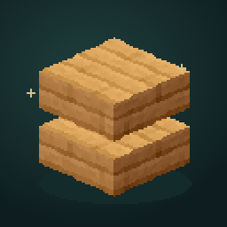

# Slabs2Blocks

**Craft two matching slabs back into one full block.** Place them side by side in your inventory grid or crafting table. Two oak slabs make oak planks, two stone brick slabs make stone bricks, and waxed copper keeps its wax and oxidation stage.

A vanilla Minecraft Java datapack by [myzticdev](https://mc.myztic.dev/).

**[Download Slabs2Blocks](https://github.com/myzticdev/Slabs2Blocks/releases/latest)**

## Install

1. Download the ZIP for your Minecraft Java version from the table below.
2. Place that ZIP in your world's `datapacks/` folder. On multiplayer servers, only the server needs the pack.
3. Reopen the world or run `/reload`. Check that Slabs2Blocks appears in `/datapack list enabled`.
4. Put one slab in each of two neighboring slots on the same row. Craft it manually in the grid. The pack does not automatically unlock recipe book entries.

The slabs must match exactly. Vertical pairs still work for vanilla recipes such as chiseled stone bricks and bamboo mosaic. Slabs with several vanilla source blocks return the plain material, so quartz slabs give a quartz block. The pack covers slabs with a standard vanilla crafting recipe in your version.

## Downloads by Minecraft Java version

| Minecraft Java | Install this ZIP |
| --- | --- |
| 26.4 Snapshot 1 through Pre-Release 1 (preview) | [Slabs2Blocks-26.4-snapshot-1-to-pre-1.zip](https://github.com/myzticdev/Slabs2Blocks/releases/latest/download/Slabs2Blocks-26.4-snapshot-1-to-pre-1.zip) |
| 1.20.2 – 26.3 (includes 1.21.11) | [Slabs2Blocks-1.20.2-26.3.zip](https://github.com/myzticdev/Slabs2Blocks/releases/latest/download/Slabs2Blocks-1.20.2-26.3.zip) |
| 1.20 – 1.20.1 | [Slabs2Blocks-1.20-1.20.1.zip](https://github.com/myzticdev/Slabs2Blocks/releases/latest/download/Slabs2Blocks-1.20-1.20.1.zip) |
| 1.19.4 | [Slabs2Blocks-1.19.4.zip](https://github.com/myzticdev/Slabs2Blocks/releases/latest/download/Slabs2Blocks-1.19.4.zip) |
| 1.19 – 1.19.3 | [Slabs2Blocks-1.19-1.19.3.zip](https://github.com/myzticdev/Slabs2Blocks/releases/latest/download/Slabs2Blocks-1.19-1.19.3.zip) |
| 1.18.2 | [Slabs2Blocks-1.18.2.zip](https://github.com/myzticdev/Slabs2Blocks/releases/latest/download/Slabs2Blocks-1.18.2.zip) |
| 1.18 – 1.18.1 | [Slabs2Blocks-1.18-1.18.1.zip](https://github.com/myzticdev/Slabs2Blocks/releases/latest/download/Slabs2Blocks-1.18-1.18.1.zip) |
| 1.17 – 1.17.1 | [Slabs2Blocks-1.17-1.17.1.zip](https://github.com/myzticdev/Slabs2Blocks/releases/latest/download/Slabs2Blocks-1.17-1.17.1.zip) |
| 1.16.2 – 1.16.5 | [Slabs2Blocks-1.16.2-1.16.5.zip](https://github.com/myzticdev/Slabs2Blocks/releases/latest/download/Slabs2Blocks-1.16.2-1.16.5.zip) |
| 1.16 – 1.16.1 | [Slabs2Blocks-1.16-1.16.1.zip](https://github.com/myzticdev/Slabs2Blocks/releases/latest/download/Slabs2Blocks-1.16-1.16.1.zip) |
| 1.15 – 1.15.2 | [Slabs2Blocks-1.15-1.15.2.zip](https://github.com/myzticdev/Slabs2Blocks/releases/latest/download/Slabs2Blocks-1.15-1.15.2.zip) |
| 1.14 – 1.14.4 | [Slabs2Blocks-1.14-1.14.4.zip](https://github.com/myzticdev/Slabs2Blocks/releases/latest/download/Slabs2Blocks-1.14-1.14.4.zip) |
| 1.13 – 1.13.2 | [Slabs2Blocks-1.13-1.13.2.zip](https://github.com/myzticdev/Slabs2Blocks/releases/latest/download/Slabs2Blocks-1.13-1.13.2.zip) |

Prefer a single download for multiple worlds? Extract the [All-Versions bundle](https://github.com/myzticdev/Slabs2Blocks/releases/latest/download/Slabs2Blocks-myzticdev-All-Versions.zip) and install one inner ZIP per world.

## More from myzticdev

[Flesh2Leather](https://github.com/myzticdev/Flesh2Leather) · [Wool2String](https://github.com/myzticdev/Wool2String) · [CraftSaddles](https://github.com/myzticdev/CraftSaddles) · [mc.myztic.dev](https://mc.myztic.dev/)

Found a recipe that behaves unexpectedly? Include your Minecraft version and slab type when you [open an issue](https://github.com/myzticdev/Slabs2Blocks/issues).
